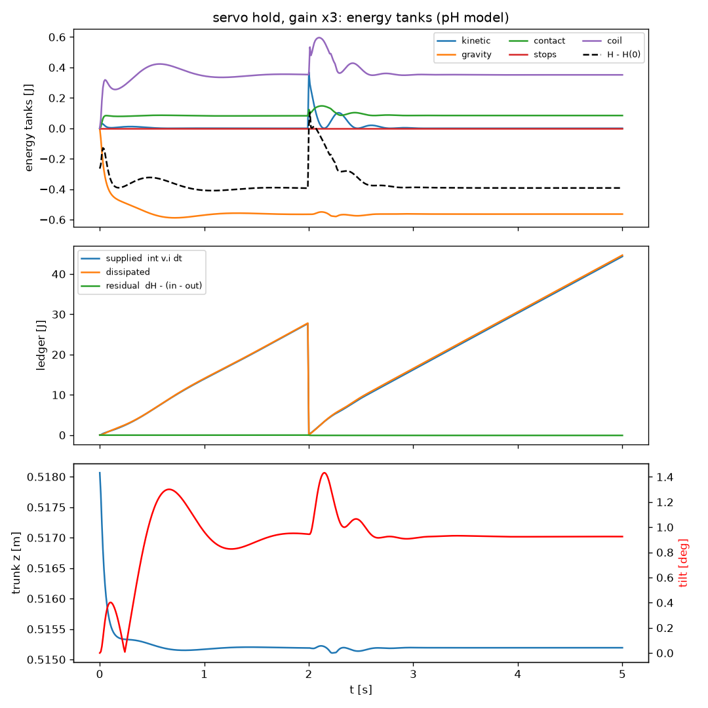
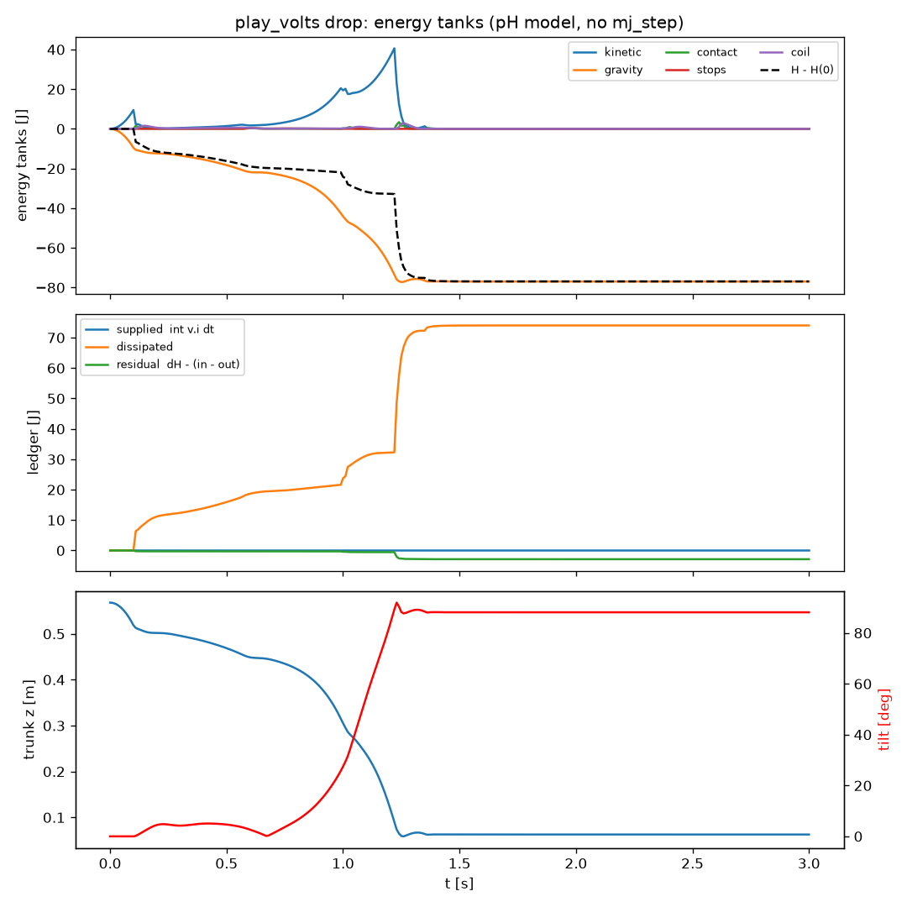
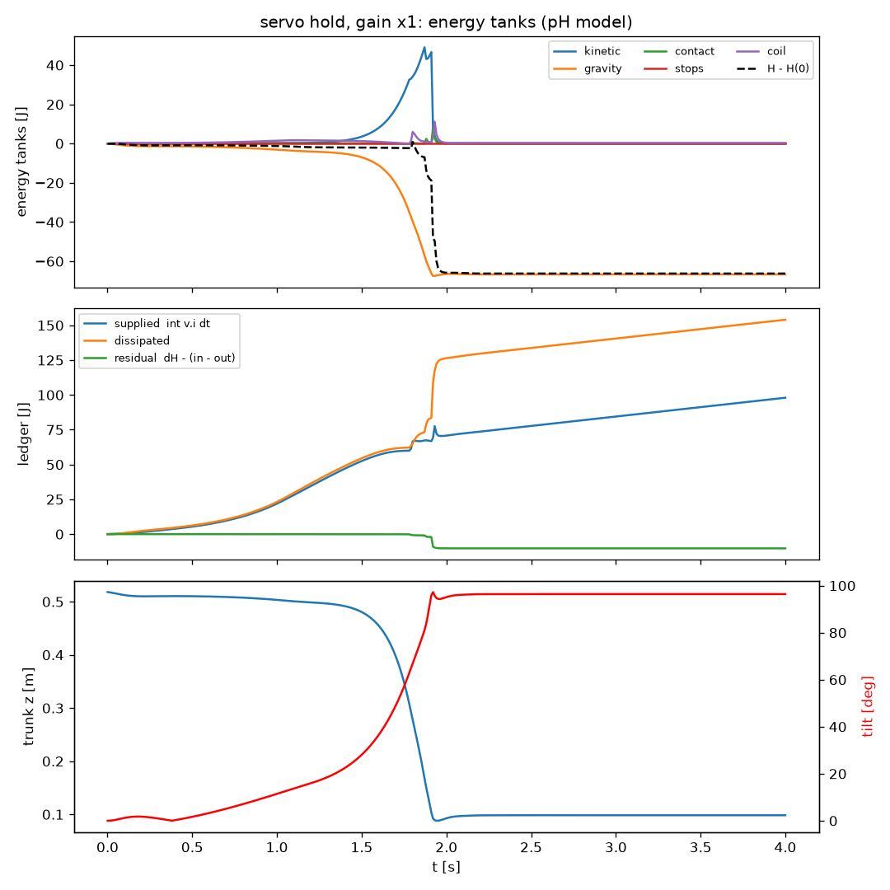

# K1 Full Body — port-Hamiltonian physics for the Booster K1

The whole **Booster K1** humanoid simulated as **one dissipative port-Hamiltonian
system**: free trunk, 22 hinges, 22 DC motors and foot–ground contact. The only
input is the **voltage on the 22 motor coils**. `mj_step` is never called. MuJoCo is
used for only three things:

1. reading the robot description (MJCF) once: masses, inertias, axes, armature, joint ranges, collision boxes;
2. drawing the robot (`mj_kinematics` in the viewer);
3. serving as the reference our numbers are checked against (`validation/checks.py`).

Part of the master thesis *Physics-informed Reinforcement Learning for Soccer
Robots* (Akos Eross, HTWK Leipzig). The repository has two halves:
- **the physics**: the pH plant in Python (`ph_k1/`, the reference) and in C++/CUDA (`ph_k1_cuda/`, the same
  numbers, fast enough to train on), with the robot's firmware command path, validated in `validation/`;
- **the RL training** on top of it (`rl/`): `rl/stand/` (stand still, the firmware's `stand` agent, trained on
  Kaggle) and `rl/getup/` (get up from lying and stay up, with a port-Hamiltonian controller: variable impedance
  made passive by an energy tank, and rewards from the Hamiltonian and the energy ledger; trained on Colab).

## Where is what

```
ph_k1/          PHYSICS, Python reference: model, dynamics, motors, contact, plant (H, J, D, G),
                firmware command path, native.py = the C++/CUDA plant behind the same interface
ph_k1_cuda/     PHYSICS, C++/CUDA: include/ph_k1 (the physics), src (CPU, CUDA, Python bindings), tests
validation/     checks.py: the physics against MuJoCo, autograd and the datasheets (9 checks)
examples/       hand-commanded experiments: play_volts, hold_pose, servo_video
benchmarks/     speed: pH plant (torch / native) vs MJX
rl/             RL TRAINING on the pH plant
  common/       the PPO harness (W&B, checkpoints + deploy.bin, videos, time budget, clean stop, resume)
                and the firmware's policy file format
  stand/        stand still under pushes: contract (= firmware obs/actions), env, train (PPO + W&B),
                export (-> deploy.bin for the robot), eval_mujoco (laptop sim-to-sim check), tests
  getup/        get up and stay up: contract (StandupAgent + gains), impedance (the energy tank), lying
                (start states), env (pH rewards, curriculum), train (by time), eval_mujoco, tests
kaggle/         GPU runs that clone this repo: TASK=stand kaggle/run.sh (training), kaggle/run.sh (benchmark)
colab/          colab-train job k1-getup.yaml + setup_gpu.sh (the get-up training), the benchmark notebook
assets/K1/      Booster K1 MJCF + meshes
docs/           figures used in this README
```

The RL side only talks to the physics through `K1PHPlantNative.policy_step(targets, kp, kd)`: 22 joint
targets (and, for rl/getup, the gains) every 20 ms, the same way the real K1 is commanded.



*Servo hold on pH physics, knocked sideways at 20 cm/s at t = 2 s. The kinetic
energy spike is absorbed by coils and contact dampers. The energy ledger
(supplied vs dissipated) stays balanced.*

---

## The model

```
x = (q, p, xi, lambda)
    q      (29)  trunk position r, trunk quaternion Q, 22 hinge angles theta
    p      (28)  p = M(q) nu,   nu = (omega_B, v_B, theta_dot)   (trunk twist in trunk frame)
    xi  (128,2)  tangential "bristles" of the 128 contact points
    lambda (22)  coil fluxes, lambda = L i

H(x) = 1/2 p^T M(q)^-1 p  +  V_grav(q)  +  V_contact(q, xi)  +  V_stops(theta)  +  sum_j lambda_j^2 / (2 L_j)

x_dot = (J(x) - D(x)) dH/dx + G v,        y = G^T dH/dx = i
```

```
        q         p          xi       lambda
q  [ 0        S_q        0        0      ]        D = diag(0, D_p, 0, R)
p  [ -S_q^T   J_gyro(p)  -J_t^T   B K_s  ]        G = [0; 0; 0; I_22]
xi [ 0        J_t        0        0      ]
λ  [ 0        -K_s B^T   0        0      ]
```

| Block | Meaning |
|---|---|
| `S_q` | Kinematics: `r_dot = R v_B`, `Q_dot = ½ Q ⊗ (0, ω_B)`, `theta_dot = theta_dot` |
| `−S_qᵀ` | Forces from positions push on the momenta: gravity, ground springs, end stops, ∂T/∂θ |
| `J_gyro(p)` | Gyroscopic (Lie-algebra) block of the free trunk. Skew on its own, so it only turns the momentum, like a spinning top |
| `J_t` / `−J_tᵀ` | A sliding sole stretches its friction spring, and the spring pulls the foot back |
| `B K_s` / `−K_s Bᵀ` | Motor gyrator: torque `k i` into the joint, back-EMF `k θ̇` into the coil |
| `D_p` | Gearbox damping, contact dampers, end-stop dampers (`⪰ 0`) |
| `R` | Coil resistance (copper loss) |

`J = −Jᵀ` means J only moves energy between the tanks. `D ⪰ 0` only removes it.
`G` is the electrical door. Together:

```
dH/dt = ∇Hᵀ J ∇H − ∇Hᵀ D ∇H + ∇Hᵀ G v  =  vᵀi − (losses)  ≤  vᵀi        (passivity)
```

The kinetic term `∂T/∂θ` is computed **analytically** with spatial algebra:
`∂T/∂θ_k = −H_k · (S_k ×_m V_parent(k))`, where `H_k` is the momentum of the subtree
after hinge k.

### Contact as pH elements

Every contact point has three parts:
- a normal spring `½ k_n δ²`, which is a tank in H;
- a normal damper;
- a tangential "bristle" spring `½ k_t |ξ|²`, coupled to p through a skew block.

The Coulomb cone `|f_t| ≤ μ f_n` is kept by shortening the bristle (elasto-plastic
slip), which can only remove energy. The ground only pushes, never pulls.

Each foot has 4 sole points, the corners of the MJCF collision box. Every other body
with collision geometry gets the 8 corners of its bounding box, so a fallen robot
lies on the floor instead of sinking through it.

### Self-contact

Off by default. Every body with collision geometry gets a chain of spheres; two overlapping spheres of bodies more
than 2 joints apart carry a spring `½ k δ²` (a tank in H, reported in the `contact` tank) and a damper (in D). The
force is internal (equal and opposite on the two bodies), pushes only, and is solved implicitly with the rest of
`(ν, i)`.

### Motors

Each hinge has the equivalent DC motor whose full-voltage torque–speed line passes
through the Booster datasheet corners. The motor models are E6408, E4315, E4310,
E6416, R14 and HT4438:

```
L di/dt = v − R i − s k θ̇,        τ = s k i
k = V_NOM / ω_max,   R = k V_NOM / τ_stall,   L = (L/R) · R
```

`s ≤ 1` caps the torque at the effort of Eric Plass's standard K1 skill config
(`ph_k1/servo.py` = RL_Core `rl_core/envs/k1_skill_cfg.py`: knee 112, hip pitch 68, hip roll 76,
hip yaw / ankles 38.3, arms 14, head 6 N m). Armature (ankle pitch 0.0396 / roll 0.0113, arms and head
0.001), passive damping (ankles 0.2, else 0), the torque-speed corners, the stand-up gains and the
command delay (10–70 ms, kept with probability 0.3) come from the same file, not from `assets/K1`.
The firmware's target clamp uses the agent's own effort table (`firmware.AGENT_EFFORT`, sprint.cpp
`kEffort` for the stand-up agent), otherwise `k1_config.h` `effort_limit`.

### Integrator

The integrator is semi-implicit and first order:
- Configuration-dependent forces are taken at the start of the step.
- Dampers, the stiffness of contact and end-stop springs, the motor gyrator and the
  coil resistance are implicit. They are solved together as one linear system in
  `(ν, i)`.
- The trunk orientation is updated with the exponential map.

Implicit Euler on the lossless gyrator coupling can only *remove* energy, never
create it.

---

## Install and run

```bash
git clone https://gitea.naoserv.imn.htwk-leipzig.de/akos.eross/Port-Hamiltonien.git   # or GitHub akuduku/K1-Full-Body-pH
cd Port-Hamiltonien
python -m venv .venv && source .venv/bin/activate
pip install -r requirements.txt

python validation/checks.py                            # validation, about 1 min
python examples/play_volts.py joints --view            # each joint group gets a voltage ramp (trunk welded)
python examples/play_volts.py drop                     # dropped from 5 cm with 0 V (shorted coils)
python examples/hold_pose.py --gain 3 --seconds 10     # classical servo holds the stand pose
python examples/hold_pose.py --gain 3 --push 20        # ... and is knocked sideways at 20 cm/s
python examples/hold_pose.py --gain 1 --view           # firmware gains: tips over (see "Limits")

cd ph_k1_cuda && python setup.py build_ext --inplace && cd ..   # the C++ plant (CUDA where nvcc exists)
python -m pytest ph_k1_cuda/tests rl/stand/tests rl/getup/tests -q   # C++ == Python reference, the tasks
TASK=stand kaggle/run.sh ITERATIONS=3000 RUN_NAME=stand-ph-v1   # train the stand policy on a Kaggle T4
colab-train launch --browser colab/k1-getup.yaml               # train the get-up policy on a Colab T4
python rl/stand/play.py                                         # the trained stand policy: push it with the mouse,
                                                                # live energy tanks (pH plant, MuJoCo draws)
```

Plots (energy tanks, ledger, trunk height and tilt) and CSVs are written to
`outputs/`. `--view` opens the MuJoCo viewer and needs a display.

```python
from ph_k1.plant import K1PHPlant
plant = K1PHPlant(batch=64)          # 64 robots in parallel
plant.reset()                         # stand pose, soles on the floor
info = plant.step(volts)              # volts: (64, 22) tensor
plant.energy()                        # tanks of H
plant.ledger                          # supplied / dissipated energy
plant.ph_matrices()                   # explicit J, D, G, ∇H for robot 0
```

---

## Files

| Path | Content |
|---|---|
| `ph_k1/model.py` | Reads the MJCF once into torch tensors (tree, masses, contact points) |
| `ph_k1/spatial.py` | Spatial vectors and quaternions |
| `ph_k1/dynamics.py` | Forward kinematics, `M(q)`, analytic `∂T/∂θ`, gyroscopic block, gravity |
| `ph_k1/motors.py` | 22 DC motors from the datasheet torque–speed curves |
| `ph_k1/contact.py` | Contact and end-stop parameters |
| `ph_k1/self_contact.py` | Self-collision: spheres on the bodies, pair elements (off by default) |
| `ph_k1/plant.py` | **`K1PHPlant`**: state, `step(volts)`, `energy()`, energy ledger, `ph_matrices()` |
| `ph_k1/drive.py` | Classical servo of the physics checks: target angles → volts (not the robot's path) |
| `ph_k1/robot_params.py` | Per-robot parameter rows `plant.robot_params` (B, 49): factors on the contact constants, added joint damping, factors on the torque ceilings; for domain randomisation and system identification (`../Model Based RL`) |
| `ph_k1/firmware.py` | **The robot's command path** (K1_Deploy firmware): filter, delay line, motor driver, IMU; Python reference |
| `ph_k1/native.py` | **`K1PHPlantNative`**: the plant + command path in C++/CUDA (`ph_k1_cuda/`), `policy_step(targets)` |
| `ph_k1/video.py` | Headless MP4 of the plant (MuJoCo only draws) for W&B |
| `ph_k1/render.py` | Viewer (drawing only) and energy-tank plots |
| `ph_k1_cuda/` | The plant and command path in C++ (one source for CPU and CUDA), its build and tests |
| `validation/checks.py` | Validation suite |
| `examples/` | Hand-commanded experiments: `play_volts.py`, `hold_pose.py`, `servo_video.py` (servo hold video for W&B) |
| `benchmarks/` | Speed of the plant (`benchmark_ph.py --impl torch\|native`), MJX on the same robot (`benchmark_mjx.py`) |
| `rl/common/` | PPO harness shared by the skills (W&B, time-based checkpoints and videos, clean stop, resume with the curriculum) and the `.bin` format |
| `rl/stand/` | **Stand policy** on the pH plant, as the firmware's `stand` agent: env, rsl-rl training (Kaggle), export to the robot's `.bin`, MuJoCo check |
| `rl/getup/` | **Get-up policy** with a port-Hamiltonian controller (targets + stiffness + damping, energy tank) and pH rewards: env, training by time (Colab), MuJoCo check, the firmware agent it needs |
| `assets/K1/` | Booster K1 MJCF and meshes; `K1_22dof_mjx_prims.xml` = primitive collisions for MJX |
| `kaggle/`, `colab/` | GPU runs that clone this repo: the benchmark (`kaggle/run.sh`, Colab notebook), the stand training (`TASK=stand kaggle/run.sh`), the get-up training (`colab/k1-getup.yaml` for colab-train) |
| `docs/` | Figures and notes |

The plant is batched: N robots step in parallel. Each robot can have its own physical parameters
(`plant.robot_params`, `ph_k1/robot_params.py`: contact `k_n, c_n, k_t, c_t, μ` factors, added joint damping,
torque-ceiling factors; the driver gains and the delay are per robot already). Without rows the plant uses
the shared constants bit for bit. PyTorch on the laptop CPU: about 5 ms per step
for one robot, ~200 policy steps/s at best. The C++ plant (`K1PHPlantNative`, same numbers to
round-off): ~30 µs per step for one robot, ~8–9 thousand policy steps/s on the same CPU.

---

## Validation (`validation/checks.py`)

| # | Check | Result |
|---|---|---|
| 1 | `M(q)` against MuJoCo `mj_fullM` (random poses) | 2e-14 |
| 2 | Analytic `∂T/∂θ` against autograd | 2e-15 relative |
| 3 | `J = −Jᵀ` exactly, `D ⪰ 0`, `(J−D)∇H + Gv` (∇H by autograd) equals what `step()` integrates, `y = i` | 3e-15 |
| 4 | Accelerations against MuJoCo `mj_forward` under joint torques | 3e-10 relative |
| 5 | Zero-gravity flight without losses: momentum and energy errors shrink linearly with h | first order |
| 6 | Drop onto the floor at 0 V: `ΔH = supplied − dissipated`, residual shrinks with h | about 4% of the losses at h = 0.5 ms |
| 7 | Every motor type follows its datasheet torque–speed envelope | 1e-16 |
| 8 | Welded trunk, right arm: same trajectory as the separate 4-DOF arm plant | 0.63° at 2 ms. Runs only in the thesis folder, SKIP here |
| 9 | Servo holds the stand pose for 3 s on voltages only | tilt 0.9°, ΣF_z = mg, residual −0.015 J |

**Two observations about the energy balance:**
- **Standing still:** energy supplied ≈ copper loss (140.2 J vs 140.2 J over 10 s).
  H stays constant, so holding a pose turns every joule into coil heat.
- **Coils at 0 V:** supplied = 0. When the robot falls, its kinetic energy flows
  back through the gyrator and is burned in R. That is why a shorted motor acts as a
  brake.



---

## Limits and placeholders

- **Motor constants:** `V_NOM = 7 V`, `L/R = 50 ms` and gearbox damping 0.08 N·m·s/rad
  are placeholders. Torque against speed matches the datasheet, but volts and amperes
  are internal units. Real `k`, `R`, `L` and the gear ratio still have to come from
  Booster.
- **Contact numbers:** `k_n = 3e4` N/m per point (about 0.8 mm sink), `μ = 0.7`. They
  are not identified on the real robot.
- **Self-collision is simplified and off by default.** `SelfContactParams(enabled=True)` (`ph_k1/self_contact.py`, on in
  `rl/getup`) puts spheres on the bodies and a unilateral spring + damper on every overlapping pair of non-neighbours,
  integrated implicitly like the ground. No friction between limbs, and the spheres only approximate the parts.
- **End stops wider than the MJCF range.** The MJCF range is the firmware's command clamp
  (K1_Deploy `k1_config.h` has the same numbers). The real K1 went past it in its get-ups (head
  yaw +0.34 rad, elbow yaw ±0.2, ankle roll +0.16, hip roll ±0.1; the logs `getup_2236.csv`, `getup_front_2250.csv`),
  so the end-stop springs sit at the MJCF range ± 0.15 rad (the firmware's own range-check tolerance)
  and at least 0.05 rad past the measured extremes (`ph_k1/model.py` `MEASURED_RANGE`).
- **Command path = the robot's, delay not identified.** Policies command 22 joint angles; volts stay
  inside the simulator. `ph_k1/firmware.py` copies the K1_Deploy chain (position clamp, slew, target
  clamp, overspeed guard once per 20 ms; the target is held; motor-driver PD every step). The transport
  delay is randomised, 10–40 ms by default: replaying the 25 Oct front get-up through the plant fits the
  real joint lags best with no slew and about 20 ms (mean error +5 ms; the hips stay 30–40 ms slower with
  the trunk fixed in the replay).
- **First-order integrator.** Standing and slow motion close the energy balance to
  about 0.01 J. Hard impacts at h = 1 ms leave about 10–15% of the impact loss
  unaccounted, 4% at 0.25 ms.
- **The K1 firmware gains (`--gain 1`) do not keep the robot up.** As an inverted
  pendulum it needs about `m g h ≈ 85 N·m/rad` of ankle stiffness, and two ankles at
  50 N·m/rad each, minus the give of knees and hips, is not enough. This is physics,
  not a bug, and it is what an RL policy will have to fix. MuJoCo with the same gains and
  torque limits behaves the same: tilt after 3 s 96° / 3.8° / 1.7° / 0.7° at gain 1 / 1.5 / 2 / 3
  (pH plant: 96° / 4.5° / 2.1° / 0.9°).



---

## Background

The predecessor code moved the robot with MuJoCo (`mj_step`). Its "port-Hamiltonian"
parts (twist and wrench ports, motor port, a `hamiltonian` observation) were only an
energy log on top of that: the physics was still MuJoCo's. This repository writes
out H, J, D and G for the full robot and integrates them.

**Compared with the earlier right-arm pH plant**, the full-body plant:
- solves the gyrator coupling implicitly instead of with forward Euler;
- models end stops as pH springs instead of clipping the joint (which pushed the other joints);
- replaces the MuJoCo contact oracle with pH contact elements;
- computes `∂M/∂q` analytically instead of with finite differences.

**RL on the plant (`rl/`):** the robot has no voltage input, so a policy commands what the real K1
takes: 22 joint targets at 50 Hz, through the firmware command path inside the plant. The volts stay in
the simulator, and so does the energy ledger, which the reward can use (`rl/stand`: copper loss R·i²).
See `rl/stand/README.md` and `rl/getup/README.md`.

The Booster K1 model files in `assets/K1/` come from Booster Robotics.
